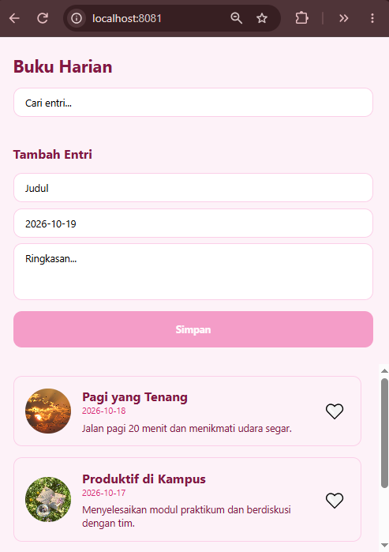

# Diary App (Buku Harian)

- **Nama:** Intan Nuraeni
- **NIM:** 2430511066

Aplikasi buku harian sederhana dengan Props dan State React Native.

# Menjalankan proyek

- Pastikan Node.js sudah terpasang.
- Install dependency: `npm install`
- Jalankan: `npx expo start`
- Scan QR dengan **Expo Go**.

# Fitur yang diselesaikan

Pada project ini, aplikasi diubah agar lebih dinamis dengan memanfaatkan Props dan State.
- Props (Properties): Digunakan untuk mengirim data dari komponen induk (parent) ke komponen anak (child).
Contoh di kode: Komponen DiaryListScreen mengirimkan teks title, date, gambar moodImage, serta fungsi callback onToggleLike ke komponen DiaryCard melalui props. DiaryCard hanya bertugas menampilkannya dan tidak bisa mengubah data aslinya.

- State: Digunakan untuk menyimpan data di dalam memori komponen yang bisa berubah-ubah, dan saat nilainya berubah, tampilan (UI) akan otomatis me-refresh (re-render).
Contoh di kode: DiaryListScreen menyimpan entries (daftar diary) dan likedIds sebagai state utama. Saat tombol "Simpan" di form ditekan, state entries diperbarui sehingga layar langsung menampilkan entri yang baru. Selain itu, SearchBar dan EntryForm juga menggunakan state lokal untuk menangani teks yang sedang diketik user.

# Screenshot

> Screenshot diambil dari expo go