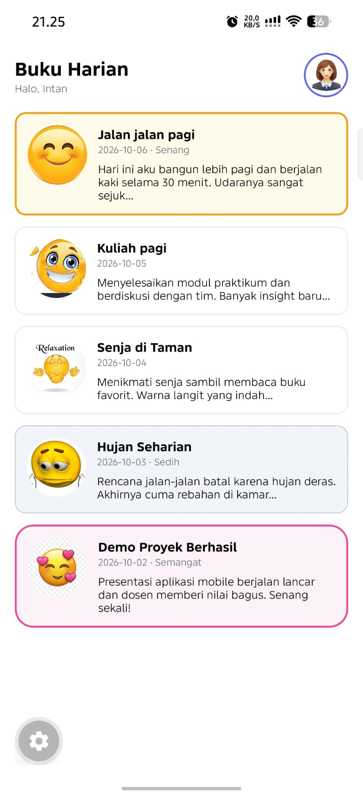

# Diary App (Buku Harian)

- **Nama:** Intan Nuraeni
- **NIM:** 2430511066

Aplikasi buku harian sederhana dengan Expo / React Native.

# Menjalankan proyek

- Pastikan Node.js sudah terpasang.
- Install dependency: `npm install`
- Jalankan: `npx expo start`
- Scan QR dengan **Expo Go**.

# Fitur yang diselesaikan

- Daftar diary berisi 5 entri (`src/data/diaryEntries.js`).
- Satu gambar remote diganti gambar lokal `assets/moods/happy.png`.
- Avatar pengguna di header memakai `Image` (`src/components/DiaryHeader.js`).
- Variasi border dan warna kartu berdasarkan mood: happy, produktif, calm down, sad, excited (`src/theme/moodStyles.js`).
- Struktur folder rapi: `components/`, `screens/`, `data/`, `theme/`, `assets/`.

# Screenshot

> Screenshot diambil dari expo go